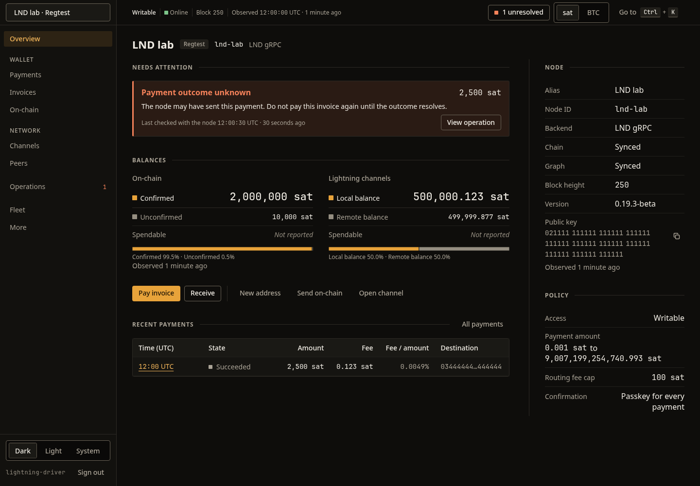
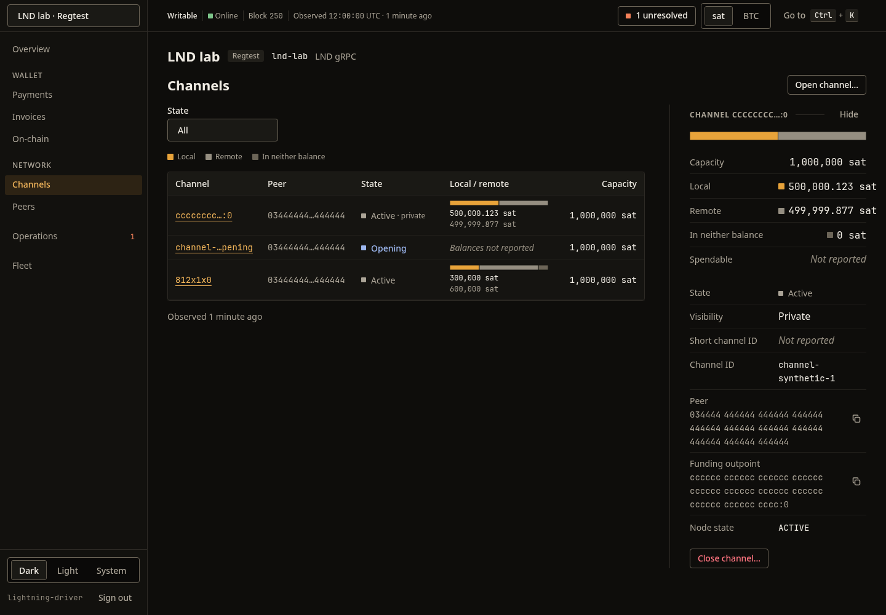
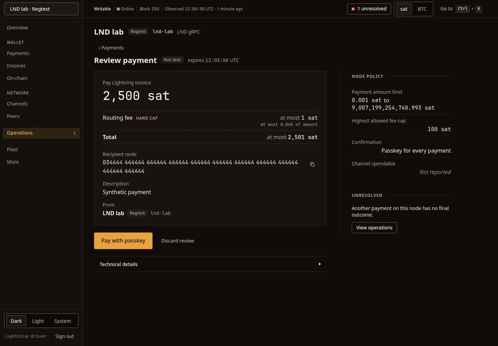
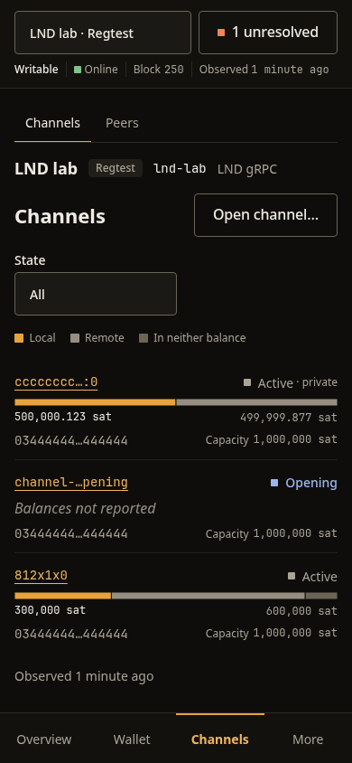

# Lightning Driver UI

Browser UI for [lightning-driver](https://github.com/jfrader/lightning-driver). It shows status,
balances, channels, invoices, payments and pending operations for LND (gRPC or REST) and Core
Lightning (REST) nodes, plus read-only chain, mempool, storage and peer data for Bitcoin Core. The
nodes come from the backend's configuration.

The backend is the Rust API server: it holds the node credentials, enforces each node's policy and
performs every node action. The browser only talks to `/api/v1` on its own origin.

Sign in with a passkey, or with a Nostr key through a NIP-07 extension. The app is Vite, TanStack
Router and TanStack Query on [@jfrader/ui](https://ui.jfrader.com) and @jfrader/tokens.



## Screenshots

| Channels and the channel inspector | Reviewing a payment |
| --- | --- |
|  |  |



`npm run screenshots` rewrites them.

## Setup

Requires Node 24 and npm.

```sh
npm ci
npm run dev
```

`npm run dev` serves on `http://127.0.0.1:5173` and proxies `/api` to a backend on loopback,
`http://127.0.0.1:8080` by default. Set `LIGHTNING_DRIVER_DEV_API_ORIGIN` to another loopback origin
(`127.0.0.1`, `localhost` or `[::1]`) if needed; any other host is refused. The backend must be
configured with the dev server's origin for its Origin and CSRF checks.

In production, build static files with `npm run build` and serve `dist/` from the same HTTPS origin as
the API, with `/api/v1/*` routed to the API server and every other path falling back to `index.html`.

## API contract

`contract/openapi.v1.json` and `contract/examples.v1.json` are consumer copies of the frozen API v1
owned by the backend (GURI-2908, Specify and implement the Lightning node-manager MVP). Do not edit
them. `npm run api:generate` checks their SHA-256 against the frozen revision and regenerates:

- `src/api/generated/schema.ts`: types (openapi-typescript 7.13.0);
- `src/api/generated/validators.js`: response and request validators (Ajv standalone with
  ajv-formats, bundled with esbuild into one self-contained ES module), so malformed amounts,
  timestamps, IDs or over-long strings are rejected before rendering.

To adopt a new frozen revision, copy both files, update the hashes in `scripts/api-contract.mjs` and
run `npm run api:generate`.

## Checks

| Command | What it does |
| --- | --- |
| `npm run api:check` | Contract snapshot hashes and generated files are current |
| `npm run lint` | ESLint |
| `npm run typecheck` | TypeScript project build, no emit |
| `npm run test` | Vitest behavior tests (jsdom, MSW with contract fixtures, 2 workers) |
| `npm run build` | Typecheck and production build |
| `npm run budget` | Builds and fails if the first-load JS or the lazy chart chunk exceeds `bundle-budget.json` |
| `npm run test:browser` | Playwright tests in headless Chromium at 390 px and 1280 px against a fresh production build, including 44 px targets, forced colors, 200% zoom, reduced motion and the phone tab-bar clearance |
| `npm run verify` | `api:check`, `lint`, `typecheck`, `test`, `build`, `budget` and `test:browser`, in that order |
| `npm run test:e2e`, `test:e2e:passkey`, `test:e2e:restart` | Opt-in real-node suite against disposable Polar/Docker regtest containers: both journeys, the passkey scenario alone, or the daemon restart drill. Needs Docker, Chromium and `LIGHTNING_DRIVER_BACKEND` pointing at a checkout with a built release API; not part of `verify` |
| `npm run screenshots` | Rewrites the README images in `docs/screenshots` from a fresh production build at 1440×1000 and 390×844; not part of `verify`, because it writes files |

`test:browser` needs a Chromium for Playwright: either `npx playwright install chromium`, or an
existing binary through `PLAYWRIGHT_CHROMIUM_EXECUTABLE_PATH=/usr/bin/chromium`. It starts and stops
its own preview server on `127.0.0.1:4317`; `screenshots` uses its own on `127.0.0.1:4318`.

The default Vitest and Playwright tests serve the frozen contract fixtures at the network boundary
(MSW in Vitest, `page.route` in Playwright). The opt-in e2e suite is what exercises the real backend,
real passkeys and real nodes; the README screenshots use the same fixtures as the default tests.
`tests/e2e/README.md` covers the stack, the scenarios and the CI dispatch.

## Amount entry

Amounts, fee rates, invoice expiry and ports are plain text fields. They accept ASCII digits and, for
amounts, one decimal point (`1500.5`). Anything else (spaces, commas, grouping, signs, exponents,
other numerals) stays as typed and is rejected. Amounts are displayed with the browser locale.

## Limitations

- Passkey ceremonies in `npm run test:browser` use a stubbed helper. The opt-in `test:e2e:passkey`
  runs a real WebAuthn round-trip against the backend with Chromium's virtual authenticator.
- Nostr sign-in uses a NIP-07 browser extension. NIP-46 remote signing and mobile bunkers are not
  implemented; the login page shows `No Nostr extension found.` when the browser has none.
- A Bitcoin Core node is read-only in this UI: chain, peers, mempool and storage. There are no wallet
  balances, peer controls or operations.
- A node that serves as a watchtower reports its identity, listeners and URIs. LND exposes no client,
  session or backup list for the serving side.
- The initial route is one chunk (about 1 MB, 273 kB gzip), including the generated validators.
  Recharts lives only in the lazy `src/charts/` chunk (about 87 kB gzip), loaded on the first chart.
